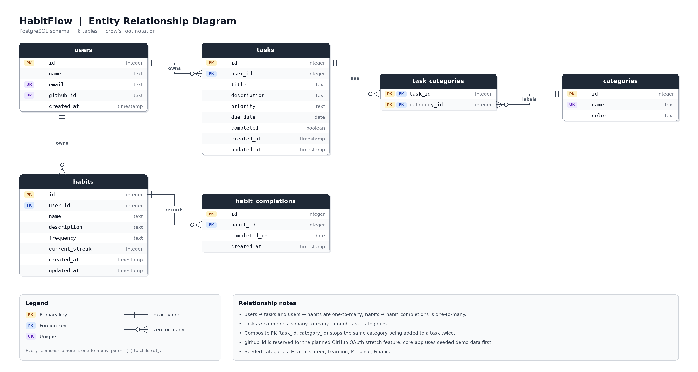
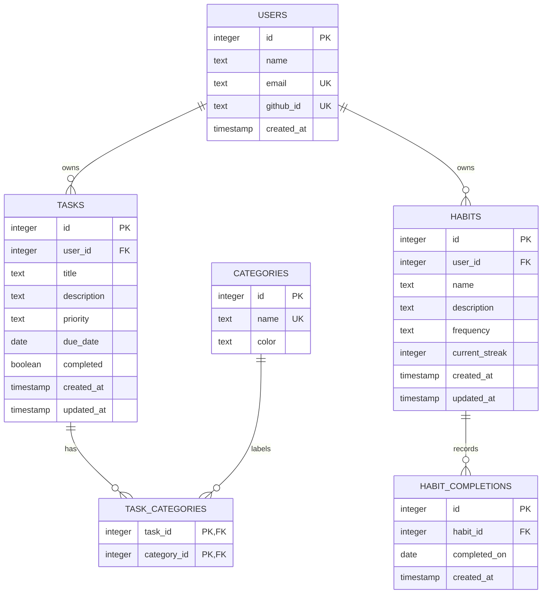

# Entity Relationship Diagram

## List of Tables

- `users`: Demo users and future GitHub OAuth identities.
- `tasks`: One-time or scheduled work items owned by a user.
- `habits`: Recurring routines owned by a user.
- `habit_completions`: Daily completion records for habits.
- `categories`: Reusable labels such as Health, Career, Learning, Personal,
  and Finance.
- `task_categories`: Join table connecting tasks and categories.

## Entity Relationship Diagram

## Relationship Notes

- `users` to `tasks` is a one-to-many relationship.
- `users` to `habits` is a one-to-many relationship.
- `habits` to `habit_completions` is a one-to-many relationship.
- `tasks` to `categories` is a many-to-many relationship implemented with
  `task_categories`.
- The composite primary key on `task_categories` prevents assigning the same
  category to the same task more than once.
- The `github_id` field is reserved for the planned GitHub OAuth stretch
  feature. The core app can use seeded demo data before authentication is added.

## Seeded Categories

The initial database state will include:

- Health
- Career
- Learning
- Personal
- Finance
