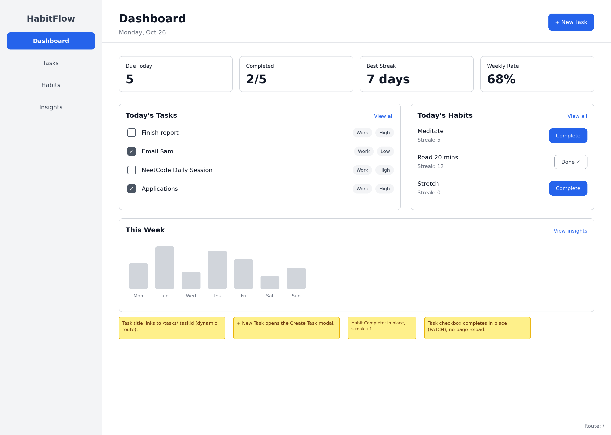
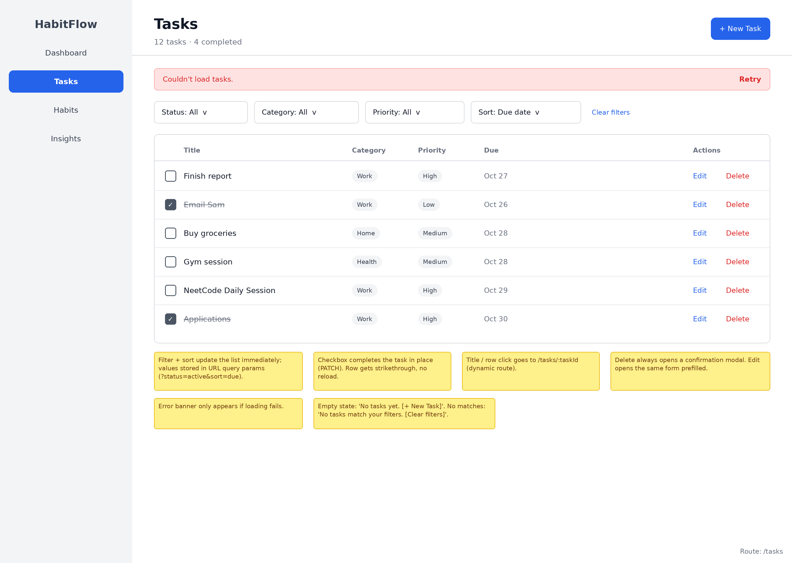
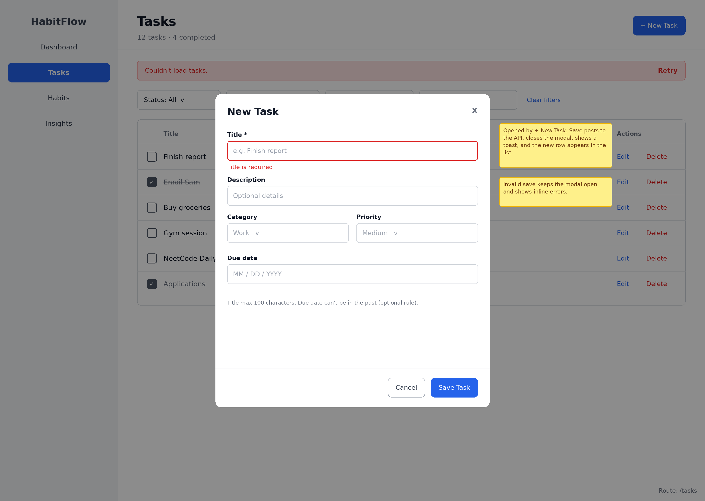
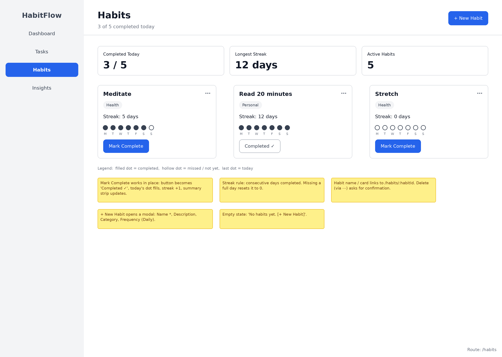

# Wireframes

HabitFlow is a productivity dashboard for managing tasks and habits, organizing them
with categories, and reviewing weekly progress.

## List of Pages

- ⭐ Dashboard (`/`)
- ⭐ Tasks (`/tasks`)
- ⭐ Habits (`/habits`)
- Task Details (`/tasks/:taskId`)
- Habit Details (`/habits/:habitId`)
- Weekly Insights (`/insights`)
- Login (`/login`, planned stretch feature)

## Wireframe 1: Dashboard

```text
+------------------------------------------------------------------+
| HabitFlow | Dashboard | Tasks | Habits | Insights | Log in       |
+------------------------------------------------------------------+
| Good morning!                                                    |
|                                                                  |
| [Completion this week: 72%] [Active streaks: 3] [Overdue: 2]    |
|                                                                  |
| Today's Tasks                              Active Habits          |
| +--------------------------------------+    +------------------+  |
| | [ ] Finish project outline   High     |    | Morning walk     |  |
| | [x] Review reading notes    Medium    |    | 5 day streak     |  |
| | [ ] Plan workout            Low       |    | [Complete today] |  |
| +--------------------------------------+    +------------------+  |
|                                                                  |
| [Add task] [Add habit]                         [View insights]   |
+------------------------------------------------------------------+
```

The dashboard gives the user a quick overview and supports same-page actions
such as completing a task or habit without navigating away.

### Figma Wireframe



## Wireframe 2: Tasks

```text
+------------------------------------------------------------------+
| HabitFlow | Dashboard | Tasks | Habits | Insights | Log in       |
+------------------------------------------------------------------+
| Tasks                                           [ + Add task ]   |
|                                                                  |
| Filter: [All statuses v] [All priorities v] [All categories v]  |
| Sort:   [Due date v]                                             |
|                                                                  |
| [ ] Finish project outline | Career | High   | Apr 20 | Edit Del  |
| [x] Review reading notes   | Learning | Med  | Apr 18 | Edit Del  |
| [ ] Plan workout           | Health | Low    | Apr 22 | Edit Del  |
|                                                                  |
| Selecting a task opens its details at /tasks/:taskId.            |
+------------------------------------------------------------------+
```

The tasks page demonstrates task CRUD, filtering, sorting, and navigation to a
dynamic task details route. The add and edit forms may be displayed in a modal
or slide-out panel.

### Figma Wireframes





## Wireframe 3: Habits

```text
+------------------------------------------------------------------+
| HabitFlow | Dashboard | Tasks | Habits | Insights | Log in       |
+------------------------------------------------------------------+
| Habits                                           [ + Add habit ]  |
|                                                                  |
| Habit name             Frequency       Current streak   Action    |
| ---------------------------------------------------------------- |
| Morning walk           Daily           5 days           [Complete]|
| Read for 20 minutes    Weekdays        3 days           [Complete]|
| Drink water             Daily           2 days           [Complete]|
|                                                                  |
| Category: [All categories v]                                      |
|                                                                  |
| Selecting a habit opens its details at /habits/:habitId.         |
+------------------------------------------------------------------+
```

The habits page focuses on recurring completion tracking and streaks. Completing
today's habit updates the streak on the same page.

### Figma Wireframe


